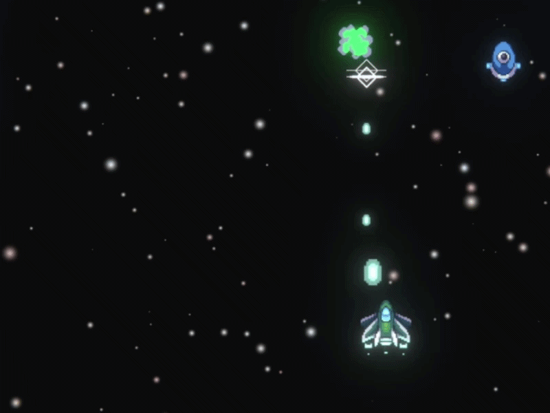

# Space Shooter

**Unity 2D Learning Project | Unity | C#**

A 2D space shooter built as part of my transition into **Unity and C# development**. The project explores fundamental gameplay programming systems, including enemy waves, weapon upgrades, power-ups, boss behavior, and player feedback.

## Project Information

| | |
| --- | --- |
| **Type** | Unity 2D Learning Project |
| **Engine** | Unity |
| **Language** | C# |
| **Platform** | Windows |
| **Status** | Completed |

## Gameplay Preview

### Enemy Waves

### Boss Fight

## Implemented Systems

**Combat and progression**
- Core shooter combat mechanics
- Dynamic enemy wave spawning
- Multiple enemy types
- Projectile and weapon upgrade systems
- Player power-ups
- Progressive difficulty

**Enemies and player systems**
- Boss encounter with multiple behavioral states
- Player health system

**Presentation**
- HUD and UI
- Animations
- Particle effects

## Technical Challenges & Solutions

One of the main challenges was creating a **functional, readable HUD and UI** within a short development cycle. I practiced structuring gameplay information and connecting interface elements to the underlying player and combat systems.

Working on the project also strengthened my understanding of **Unity's component-based workflow, C# gameplay scripting, enemy behavior, and gameplay progression**.

## What I Learned

This project helped me establish practical foundations in Unity while exploring how individual gameplay systems work together in a complete 2D shooter.

## Portfolio

[See more of my work](https://richardportfolio-app.base44.app/)

**Developed by Richard Luis da Rosa.**
